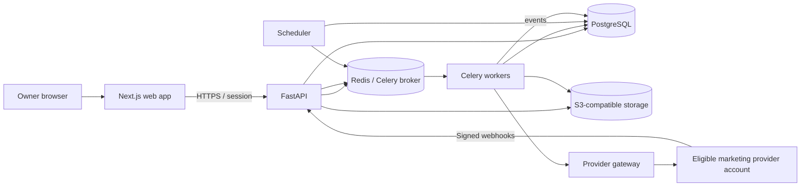
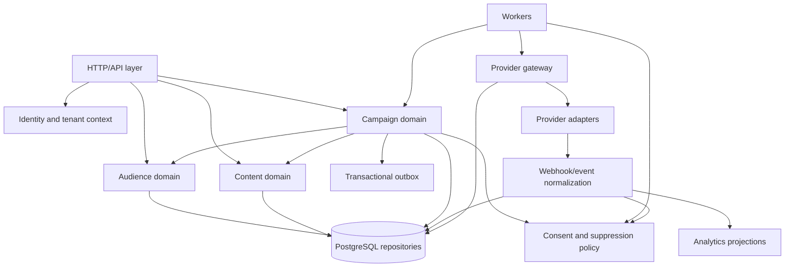

# Architecture and Design

**Product:** Personal Email Marketing Platform  
**Status:** Implementation baseline  
**Version:** 1.0  
**Related documents:** [PRD.md](PRD.md) · [SPEC.md](SPEC.md)

## 1. Architecture overview

Phase 1 is a single-owner deployment with one workspace. The system is modular-monolith first: a FastAPI application exposes domain services, while separate Celery workers execute imports, campaign preparation, dispatch, and event processing. PostgreSQL owns durable business state; Redis transports tasks and supports short-lived rate limiting; S3-compatible object storage holds staged uploads and optional assets.



The gateway is the only outbound email boundary. Campaign logic produces normalized outbound messages, never provider-specific requests. Provider-specific responses return to a normalized state/event model.

## 2. Major modules and responsibilities

| Module | Owns | Must not do |
|---|---|---|
| Identity/workspace | Google OIDC, sessions, owner allowlist, tenant context | Trust tenant ID supplied by a browser request |
| Audience | Contacts, imports, tags, segment AST, consent, suppressions | Send email or execute raw SQL from segment definitions |
| Content | GrapesJS project JSON, MJML, sanitized HTML/text, rendering | Permit script or arbitrary remote code in template |
| Campaign | Draft/state transitions, snapshots, recipient ledger, pause/cancel | Call providers directly or mutate consent state |
| Scheduler/outbox | Find due work and reliably publish tasks | Treat Redis as the durable source of campaign state |
| Gateway/router | Eligibility, capacity/rate policy, adapter selection, normalized results | Rotate keys/accounts to bypass a quota, policy, or review |
| Provider adapters | Provider API/webhook semantics, signatures, idempotency and reconciliation | Make unsupported claims about plan eligibility |
| Event processor | Deduplication, normalized events, suppression effects, analytics | Assume webhook order or uniqueness without dedupe |
| Operations | Health, metrics, audit, backups, global/per-account pause | Log secrets or recipient PII in metric labels |

## 3. Data and control flows

### 3.1 Import

1. Browser requests an import and receives a constrained signed object-storage URL.
2. CSV is uploaded to a private staging bucket. API checks ownership, size, digest and file format.
3. Import worker parses bounded batches, normalizes addresses, applies mapping and validation, and writes row outcomes idempotently.
4. Preview provides accepted/duplicate/invalid/missing-consent counts and row-level error codes.
5. Owner commits with explicit duplicate merge policy. Contact and import state update transactionally; staged file is deleted per retention policy.

### 3.2 Template to campaign

1. Browser stores GrapesJS editor state and MJML through content API.
2. Server validates components, renders MJML to HTML/text, sanitizes output and creates a versioned template.
3. Campaign references a template version and segment definition. Preview resolves sample contact data with escaped variables.
4. Launch validation checks marketing sender eligibility, verified sender identity, consent settings, capacity freshness, campaign state, and content safety.
5. Launch snapshot captures content plus recipient identities. Current suppression remains authoritative at dispatch time.

### 3.3 Scheduled dispatch and provider result

```mermaid
sequenceDiagram
  participant API as FastAPI
  participant DB as PostgreSQL
  participant OUT as Outbox dispatcher
  participant Q as Redis/Celery
  participant WK as Send worker
  participant GW as Gateway
  participant PV as Provider account
  API->>DB: lock campaign, snapshot, recipients, outbox
  OUT->>DB: claim unpublished outbox rows
  OUT->>Q: publish recipient batch
  WK->>DB: claim recipient; recheck consent/suppression
  WK->>GW: request marketing account selection
  GW->>DB: reserve eligible account capacity
  WK->>DB: persist attempt/idempotency key
  WK->>PV: submit message
  PV-->>WK: accepted / definitive rejection / ambiguous
  WK->>DB: persist result (ambiguous => unknown)
  PV-->>API: signed webhook event
  API->>DB: persist deduplicated raw/normalized event
  API->>Q: enqueue event processing
  Q->>DB: update recipient state, suppression, analytics
```

If the network result is ambiguous, worker stores `unknown` and ends that send path. Reconciliation checks provider event/API state or provider idempotency guarantees. An operator may resolve irrecoverable ambiguity with a recorded decision. Never blind-failover the same recipient after an ambiguous attempt.

### 3.4 Unsubscribe and suppression

The signed unsubscribe token identifies tenant and opaque recipient reference without exposing the email address. GET displays a simple confirmation page where required; POST one-click action immediately upserts suppression and records an event. Dispatch queries suppression immediately before provider submit. Provider complaint/hard-bounce events follow the same idempotent suppression path.

### 3.5 Provider quota-aware selection

Account candidates are filtered by tenant, verified marketing eligibility, sender domain, account health, freshness of account-specific capacity, remaining quota reservation, and rate token. Router applies operator-configured priority/weights within compliant capacity. Account quota belongs to provider-side account, not API credential. A stale or unknown capacity snapshot blocks use or requires explicit operator refresh. Current free-tier terms and quotas are never embedded as product facts; operators must verify provider-specific eligibility and account state.

## 4. Module dependencies



Domain services depend on repository interfaces and typed events. Web/API, workers, and scheduler share the same domain package, but provider SDK code remains isolated under adapters. Do not introduce microservices until independent scaling or operational boundaries justify them.

## 5. Repository structure

```text
email-platform/
├── apps/
│   └── web/                         # Next.js UI
│       ├── app/                     # Routes and layouts
│       ├── components/              # Shared interface components
│       ├── features/                # Audience, editor, campaign, analytics
│       └── lib/                     # Session-aware API client
├── services/
│   └── api/                         # FastAPI entry point and HTTP routes
│       ├── app/main.py
│       ├── app/api/v1/              # Request/response schemas and routes
│       ├── app/auth/                # OIDC, sessions, tenant resolution
│       ├── app/domain/              # Identity, audience, content, campaign, gateway
│       ├── app/repositories/        # Tenant-scoped persistence
│       ├── app/workers/             # Celery tasks, scheduler, outbox
│       ├── app/providers/           # Adapter contract and implementations
│       ├── app/events/               # Webhook verification and event reducer
│       └── app/security/            # Encryption, sanitization, tokens
├── packages/
│   ├── api-client/                  # Generated/typed frontend API client
│   └── shared-schemas/              # Stable shared schemas if useful
├── migrations/                      # Alembic migrations
├── infra/
│   ├── compose.yaml
│   ├── docker/                      # Dockerfiles
│   └── monitoring/                  # Dashboards and alert examples
├── docs/
│   ├── runbooks/                    # Backup, restore, incidents, provider setup
│   └── decisions/                   # Architecture decision records
├── tests/
│   ├── unit/
│   ├── integration/
│   ├── e2e/
│   └── fixtures/
├── .env.example                     # Names and safe local placeholders only
├── pyproject.toml
├── package.json
└── README.md
```

The root files [PRD.md](PRD.md), [SPEC.md](SPEC.md), and [ARCHITECTURE.md](ARCHITECTURE.md) are product-level source documents. Keep implementation-specific decisions in `docs/decisions/` and update these three documents when a decision changes a contract or invariant.

## 6. Deployment topology

### Phase 1 local/single-host

Docker Compose runs web, API, worker, scheduler, PostgreSQL, Redis, optional local S3-compatible service, and one-time migration. TLS and public DNS terminate at an operator-managed reverse proxy. Restrict database, Redis, object store and metrics ports to the private network. Scheduler uses a PostgreSQL lease/advisory lock so accidental duplicate instances do not double-enqueue.

### Phase 1 production single-owner

Prefer managed PostgreSQL, managed Redis where practical, private object storage, external secret manager, TLS ingress, and monitored encrypted backups. Worker concurrency and provider limits are configured conservatively. Compose alone does not provide high availability, automatic failover, or disaster recovery.

### Phase 2 SaaS

Add tenant onboarding and membership service, tenant quota/billing and abuse controls, tenant-aware secrets, webhook account mapping, support audit, RLS defense-in-depth, and scalable worker pools. Keep database tenant IDs and service interfaces from Phase 1 so migration is additive. See [SPEC.md](SPEC.md) for the migration sequence.

## 7. Cross-cutting operations

- **Consistency:** PostgreSQL owns state. Use transactional outbox for queued work and idempotent consumers for Celery at-least-once delivery.
- **Concurrency:** Claim work with row locks/leases and `SKIP LOCKED`; unique keys stop duplicate recipient/event creation.
- **Security:** Tenant context propagates through request, task and event envelopes; every persistence entry point enforces it.
- **Observability:** Correlate request, campaign, recipient opaque ID, provider account and attempt. Do not place raw email or secret in logs/metrics.
- **Capacity:** Monitor Postgres storage, object storage, queue lag, recipient throughput, event backlog and backup age. Contact count is limited by installed infrastructure, not a product hard cap.
- **Recovery:** Retry safe tasks; expose ambiguous provider sends as unknown; use reconciliation, not blind resend. Backups must be restored in drills.
- **Privacy:** Retention applies to raw imports, provider payloads, campaign snapshots, events and backups; purge by configured policy while preserving only necessary suppression/audit evidence.

## 8. Architecture risks and decision record

| Decision/risk | Resolution |
|---|---|
| Modular monolith vs microservices | Start modular monolith plus isolated worker processes; split only with measured operational need. |
| Queue delivery is at least once | Outbox, idempotency keys, durable recipient ledger and idempotent webhook processing. |
| Provider timeout cannot establish non-acceptance | Explicit `unknown` state and reconciliation; no automatic alternate-account resend. |
| Account quota and API key are easily conflated | Separate account and credential entities; reserve capacity by account. |
| Marketing vs transactional eligibility differs by provider/account | Explicit message-class eligibility verified by operator and provider-specific adapter evidence. |
| Single-user Phase 1 could encourage unsafe global queries | Tenant ID required in schema, repository context and task/event envelope from initial implementation. |
| Provider policy changes | Store verification date/evidence, refresh provider facts and disable accounts on stale eligibility/capacity. |

See [SPEC.md](SPEC.md) for exact schemas, API contracts, retry semantics, event fields, deployment configuration and release gates; see [PRD.md](PRD.md) for user-facing acceptance criteria and milestones.
